<picture>
  <source media="(prefers-color-scheme: dark)" srcset="assets/header-dark.svg">
  <source media="(prefers-color-scheme: light)" srcset="assets/header-light.svg">
  
</picture>

I make small, focused tools that remove a bit of daily friction: native Mac apps in SwiftUI, mods for Claude Code, and the occasional Chrome extension. All of it is free, and most of it is open source.

## Mac apps

| App | What it does |
| --- | --- |
| **[Folderpad](https://github.com/falconsw/folderpad)** | App folders in the Dock for macOS 26, now that Launchpad is gone. |
| **[LaunchSet](https://github.com/falconsw/launchset)** | Open a whole set of apps (Morning, Work, Evening…) in one click from the menu bar. |
| **[Kestirme](https://github.com/falconsw/kestirme)** | Hold <kbd>⌘</kbd> to see every keyboard shortcut of the frontmost app; search and run them. |
| **[Dürücü](https://github.com/falconsw/durucu)** | Look inside ZIP, 7Z, RAR and TAR before extracting; create encrypted archives. |
| **Süpürücü** | Menu bar storage reclaimer and app uninstaller. |

All of them install with Homebrew from [`falconsw/tap`](https://github.com/falconsw/homebrew-tap):

```sh
brew install --cask falconsw/tap/folderpad   # or launchset, kestirme, durucu, supurucu
```

## AI & developer tools

- **[cost-info](https://github.com/falconsw/cost-info)**: live cost, tokens and plan limits under the Claude Code prompt.
- **[project-memory](https://github.com/falconsw/project-memory)**: one shared project memory for Claude Code and Cursor.
- **[maps-lead-scraper](https://github.com/falconsw/maps-lead-scraper)**: Chrome extension that exports Google Maps businesses to CSV.

## Stack

**Languages:** Swift · TypeScript · JavaScript · PHP · Python · Dart · Kotlin · Go  
**Apps & web:** SwiftUI · React · React Native · Flutter · Angular · Ionic · Next.js · Vue · Tailwind CSS  
**Backend:** Node.js · NestJS · Express · Laravel · Firebase  
**Automation & tooling:** n8n · Docker · Chrome extensions · Claude Code

## Find me

[X](https://x.com/falconsoftw) · [LinkedIn](https://www.linkedin.com/in/falconsw/) · [doganomer.com](https://doganomer.com)
